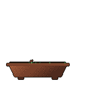

## Hi, I'm Quang 👋

Software engineer in Boston, MA · CS grad from [UMass Lowell](https://www.uml.edu/) · previously a cybersecurity software engineer at Schneider Electric.

[Portfolio](https://quangt23.github.io/qt-codes-portfolio/) · [LinkedIn](https://www.linkedin.com/in/quang-tran-308074225/) · [Email](mailto:quangtbusiness@gmail.com)

 

<picture>
  
</picture>

<a href="https://github.com/quangt23">
  <picture>
    <source media="(prefers-color-scheme: dark)" srcset="https://github-readme-stats.vercel.app/api?username=quangt23&amp;hide_border=true&amp;disable_animations=true&amp;bg_color=00000000&amp;title_color=7ee787&amp;text_color=c9d1d9&amp;icon_color=56d364&amp;card_width=400&amp;show_icons=true&amp;rank_icon=github&amp;ring_color=7ee787">
    
  </picture>
</a>
 
<a href="https://github.com/quangt23?tab=repositories">
  <picture>
    <source media="(prefers-color-scheme: dark)" srcset="https://github-readme-stats.vercel.app/api/top-langs/?username=quangt23&amp;hide_border=true&amp;disable_animations=true&amp;bg_color=00000000&amp;title_color=7ee787&amp;text_color=c9d1d9&amp;card_width=400&amp;layout=compact&amp;size_weight=0&amp;count_weight=1&amp;langs_count=6&amp;hide=html%2Ccss%2Cjupyter+notebook%2Cshell%2Cdockerfile%2Cmakefile&amp;custom_title=Languages+by+repo+count">
    
  </picture>
</a>

 

### Recent projects

| Project | What it is |
| --- | --- |
| [8bit-K8s](https://github.com/quangt23/8bit-K8s) | GPU orchestration with a cozy 8-bit pixel-art control room · TypeScript |
| [styleAI](https://github.com/quangt23/styleAI) | AI-centered clothing site · TypeScript |
| [SeedScape](https://github.com/quangt23/SeedScape) | Web garden game: grow, collect mutations, sell for coins · JavaScript |
| [Photo-Encrypter](https://github.com/quangt23/Photo-Encrypter) | Image encryption with a linear feedback shift register · C++ |

### Tech

**Languages** · TypeScript, JavaScript, Python, C++, C 
**Web** · React, HTML, CSS 
**Tools** · Git, VS Code, Valgrind
